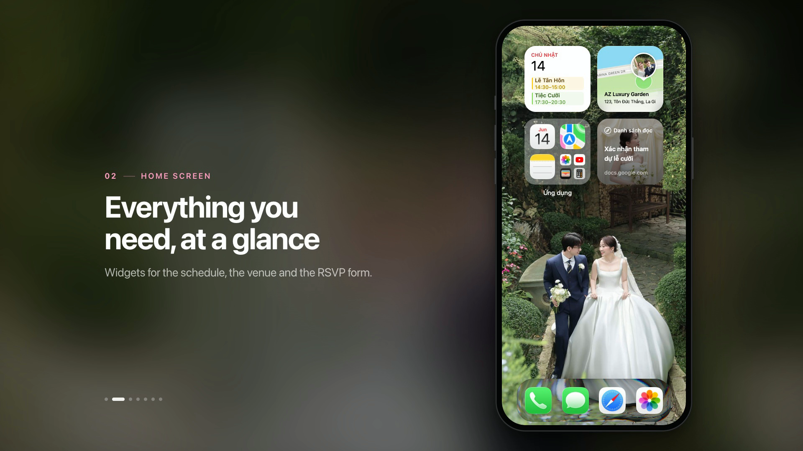
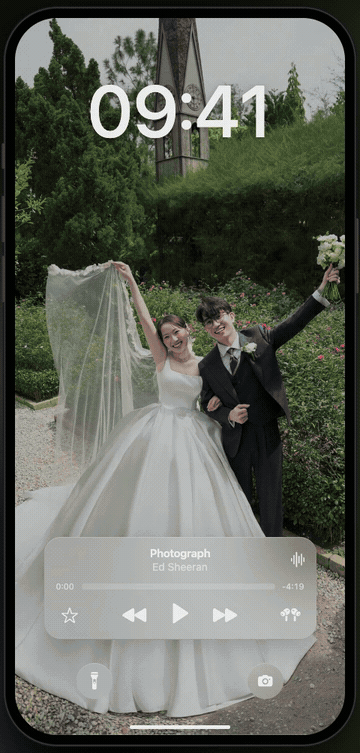

# iPhone Wedding Invitation

**A wedding invitation website disguised as an iPhone.**

We (Trí & Như) got married in June 2026. Instead of sending a PDF card, we sent our guests a link. It opens on a lock screen with a photo and a wedding playlist ready to play. Unlock it and you get a home screen full of apps that actually open.

Under the fun, it does the usual invitation jobs: tells people when and where, shows off the photos, and gets everyone to RSVP. This repo is that invitation as a free, open-source template. Our photos and texts are swapped for samples, so you can drop in your own and have your digital wedding invitation live on Vercel in a few minutes.

[](https://vercel.com/new/clone?repository-url=https%3A%2F%2Fgithub.com%2Fnguyenhuugiatri%2Fiphone-wedding-invitation&project-name=iphone-wedding-invitation&repository-name=iphone-wedding-invitation)

**Live demo:** [iphone-wedding-invitation.vercel.app](https://iphone-wedding-invitation.vercel.app)

<p align="center">
  <a href="docs/demo/demo.mp4">
    
  </a>
  <br>
</p>

https://github.com/user-attachments/assets/7df48880-b32b-4f9e-b8db-c819a7d22c68

## Tiếng Việt

**Thiệp cưới online giao diện iPhone**, mã nguồn mở và miễn phí. Khách mở link thiệp là thấy màn hình khoá với ảnh cưới và playlist nhạc cưới. Mở khoá ra là màn hình chính với các app bấm vào được: xác nhận tham dự qua Google Form trong Safari, ngày giờ trong Lịch, chỉ đường trong Bản đồ, album ảnh cưới trong Ảnh và mã QR mừng cưới trong Ví.

Muốn làm thiệp cưới điện tử cho đám cưới của mình: fork repo, thay ảnh và thông tin trong vài file (xem [Make it yours](#make-it-yours)), rồi deploy miễn phí lên Vercel bằng nút ở trên. Giao diện đã sẵn tiếng Việt.

## What it's for

Most guests open a wedding link on their phone anyway, so the invite pretends to be one. Nobody needs instructions. You swipe, you tap, things open.

It has three jobs:

1. **Collect RSVPs.** A Google Form asks whether you're coming, how many people you're bringing, and whether you want a seat on the shuttle bus. Guests find it in the Reading List widget, in Safari on the dock, and in the invite inside Notes.
2. **Show the when and where.** A Calendar widget with both events, a map widget that opens Google Maps, and the full invitation written up in Notes.
3. **Show the photos.** A Photos-style album with a masonry grid and a viewer you can swipe through.

Then there are the extras we couldn't resist: a chat between the couple, the call log from the planning weeks, a gift QR in Wallet, and a calculator that works.

## Take the tour

<table>
  <tr>
    <td align="center"><br><sub>Lock screen → Calendar → Notes → Photos</sub></td>
    <td align="center"><br><sub>Music</sub></td>
    <td align="center"><br><sub>Phone</sub></td>
  </tr>
  <tr>
    <td align="center"><br><sub>YouTube</sub></td>
    <td align="center"><br><sub>Settings</sub></td>
    <td align="center"><br><sub>Calculator</sub></td>
  </tr>
</table>

### Every app, and what it's for

| App | What guests get |
| --- | --- |
| Lock screen | A photo, the clock and a music widget. Tap play and the phone unlocks itself. |
| Home screen | Calendar, Maps and Reading List widgets, an app folder and the dock. |
| Calendar | The ceremony (14:30–15:00) and the reception (17:30–20:30), with the venue. |
| Maps | Opens the venue in Google Maps. |
| Notes | The invitation itself, with a directions link and an RSVP link. |
| Safari | The RSVP form, right inside the phone. |
| Photos | The wedding album: a masonry grid and a swipeable full-screen viewer. |
| Music | A royalty-free wedding playlist. Skip and scrub from the lock screen. |
| Messages | A short chat between the bride and groom. |
| Phone | The call log from planning: the menu, the outfits, the photographer, the car. |
| Wallet | A gift pass with a bank QR code. |
| YouTube | The "Lễ Đường" music video by Kai Đinh (a YouTube embed). |
| Settings, Calculator | Easter eggs. The toggles toggle and the math is right. |

The UI text is in Vietnamese, because our guests were. Everything is plain strings in the components, so translating it is a find-and-replace job.

## Make it yours

```bash
pnpm install
pnpm dev        # http://localhost:5173
```

Everything personal lives in a handful of files:

| What | Where |
| --- | --- |
| Names, date, event times | [`components/calendarData.ts`](components/calendarData.ts), [`src/NotesPage.tsx`](src/NotesPage.tsx), [`src/WalletPage.tsx`](src/WalletPage.tsx), [`index.html`](index.html) (title, share tags and the short intro shown beside the phone on wide screens) |
| Venue and map link | [`lib/maps.ts`](lib/maps.ts), [`components/calendarData.ts`](components/calendarData.ts) |
| Wallpapers | `public/wallpaper-lock.jpeg` (lock screen), `public/wallpaper-home.jpeg` (home screen) |
| Widget photos | `public/profile.jpeg` (Maps widget), `public/reading-list.jpeg` (Reading List widget) |
| Photos | `public/photos/`, plus the list in [`src/PhotosPage.tsx`](src/PhotosPage.tsx) |
| Playlist | `public/music/`, plus `PLAYLIST` in [`src/music/MusicProvider.tsx`](src/music/MusicProvider.tsx) |
| RSVP form | [`scripts/wedding-form.gs`](scripts/wedding-form.gs), `HOME` in [`src/SafariPage.tsx`](src/SafariPage.tsx) |
| Gift QR | `public/gift-qr.png` (the sample just links to this repo) |
| Chat and call log | [`src/MessagesPage.tsx`](src/MessagesPage.tsx), [`src/PhonePage.tsx`](src/PhonePage.tsx) |
| Share image and icons | `pnpm gen:meta` rebuilds `og-image.jpg` from the home wallpaper (replacing the demo's designed one), and the favicons from `public/favicon.svg` |

Keep photos around 1600 px on the long edge. Nothing resizes them for you, and guests are on mobile data.

## How the RSVP works

The form is plain Google Forms, generated by [`scripts/wedding-form.gs`](scripts/wedding-form.gs) (Google Apps Script). There's no backend to run: answers collect in Google Forms, and you can link a Sheet if you'd rather work in a spreadsheet.

The questions branch based on the answers:

- Name
- Coming? If no, skip straight to leaving a message.
- How many people, kids included.
- Shuttle bus? If yes: pickup point, whether you're taking the ride there and/or back, and how many seats each way, plus a passenger list (name and birth year).
- Anything else the couple should know, and a message for them.

Guests can come back and edit their answers. `generatePrefillUrls()` builds a personal link for each guest with their name already filled in, and prints the list as TSV you can paste into a Sheet.

To set it up: paste the script into [script.google.com](https://script.google.com), run `createWeddingForm()`, then put the form URL in `HOME` in [`src/SafariPage.tsx`](src/SafariPage.tsx).

> Our wedding is over, so the form in the demo is closed. Safari shows Google's "no longer accepting responses" page until you plug in your own.

## Deploying

It's a static Vite site, so any static host works. The simplest is Vercel:

- **One click:** use the **Deploy with Vercel** button above. It forks the repo and deploys it.
- **From your own fork:** import it at [vercel.com/new](https://vercel.com/new). The Vite preset is detected automatically and every push redeploys.

[`vercel.json`](vercel.json) only adds long-lived caching for the hashed files in `/assets`. If you use your own domain, update the URLs in `index.html`, `public/robots.txt` and `public/sitemap.xml`.

## Built with

React 19 and TypeScript on Vite 8, Tailwind CSS 4, Framer Motion for all the iOS-style springs, and GSAP for the photo grid.

Spacing, type and motion follow Apple's Human Interface Guidelines. On a desktop the app sits inside a 440×956 iPhone frame; on a phone it goes full screen. SF Pro isn't bundled (its license doesn't allow it): Apple devices render it natively, and everything else falls back to the system font.

## Recording the demo videos

Everything in `docs/demo/` is recorded from the real app. Nothing is edited by hand. These takes come from our actual invitation, before the photos, chat and playlist were swapped for the samples in this repo, so re-recording gives you your own content. [`scripts/promo-video/`](scripts/promo-video) drives headless Chrome on a frozen clock and advances it exactly 1/60 s per frame, so every animation comes out smooth however slow the machine is.

```bash
pnpm add -D puppeteer-core    # also needs Google Chrome and ffmpeg
pnpm exec vite --config scripts/promo-video/vite.config.mjs --port 5199

node scripts/promo-video/main.mjs                  # docs/demo/demo.mp4
node scripts/promo-video/apps.mjs                  # docs/demo/apps/* and apps.mp4
node scripts/promo-video/apps.mjs --only=music     # a single clip (add --preview for a fast 30 fps pass)
```

Captions and the script for each scene are in [`scripts/promo-video/scenes.mjs`](scripts/promo-video/scenes.mjs).

## License

The code is [MIT](LICENSE). The sample photos (Unsplash), the music (royalty-free, attribution in [CREDITS.md](CREDITS.md)) and two components adapted from React Bits have their own licenses, listed in [CREDITS.md](CREDITS.md). Apple, iPhone, iOS and the app icons belong to Apple, and YouTube belongs to Google. This project isn't affiliated with either.
